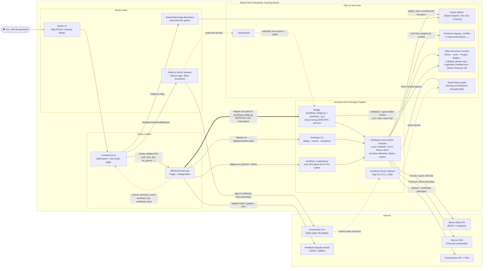
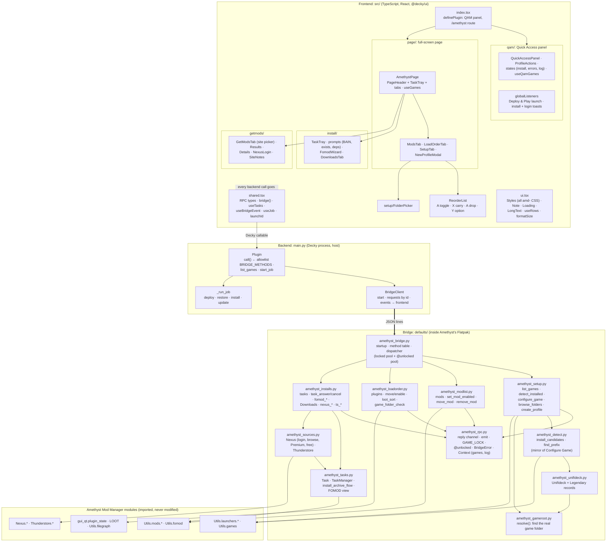

# Amethyst Deploy: how the code fits together

A guide for reviewing the plugin. It covers what each part does, how the parts talk
to each other, and where to look for what. Line counts are as of `97516a7`.

- [1. The big picture](#1-the-big-picture)
- [2. Diagram: how the plugin connects to everything](#2-diagram-how-the-plugin-connects-to-everything)
- [3. Diagram: code architecture](#3-diagram-code-architecture)
- [4. Code outline, file by file](#4-code-outline-file-by-file)
- [5. Key flows, step by step](#5-key-flows-step-by-step)
- [6. Threads, locks and events](#6-threads-locks-and-events)
- [7. Suggested review order](#7-suggested-review-order)

## 1. The big picture

The plugin is three programs that talk to each other:

| Program | Language | Where it runs | Job |
|---|---|---|---|
| **Frontend** (`src/`) | TypeScript + React | Inside Steam's UI (Gaming Mode), loaded by Decky | Everything you see: the Quick Access panel and the full-screen page. Controller only. |
| **Backend** (`main.py`) | Python | Decky Loader's process, as the `deck` user, on the host | The frontend's entry point. Runs Amethyst's CLI for deploy/restore, installs the Flatpak, and starts and talks to the bridge. |
| **Bridge** (`defaults/amethyst_*.py`) | Python | **Inside Amethyst's Flatpak**, started by the backend | Imports Amethyst's own modules, so it behaves exactly like Amethyst's GUI. Covers mods, load order, setup, installs, Nexus, Thunderstore. |

Why a bridge: Amethyst's CLI only covers `deploy`, `restore` and listing games. Everything
else (mod lists, FOMOD installers, LOOT, Nexus login) lives in Amethyst's Python modules.
The bridge runs with Amethyst's own Python and libraries, so it can import them directly.
It never modifies Amethyst's files.

Rules the code follows (from `CLAUDE.md`):
- Mirror what Amethyst's GUI does and cite the GUI function in a comment.
- Zero mouse. The agreed exceptions are pressing Authorize and Slow download on Nexus
  pages in Steam's browser.
- Host commands get a clean environment (`_user_env()`), because Decky's bundled
  `LD_LIBRARY_PATH` breaks `flatpak`.
- Stop the bridge before a deploy, restore or update job touches the same files.

## 2. Diagram: how the plugin connects to everything

**How to read it**
- **The double arrow** (backend to bridge) is the heart of the plugin. One long-lived
  process inside the Flatpak gets requests from the backend and sends back replies plus
  unrequested **events**: task progress, Nexus login results and log lines.
- **Deploy, restore and install-or-update Amethyst** don't use the bridge. They're
  separate `flatpak` commands run as jobs, and the backend stops the bridge first so the
  two never touch the same files.
- **Steam's browser** only appears in two places: the Nexus login (Authorize) and, for
  free Nexus accounts, the Slow download click. The download lands in `~/Downloads`,
  where Amethyst's watcher (run by the bridge) picks it up and installs it.

## 3. Diagram: code architecture

**How to read it**
- **Frontend:** every call to the backend goes through `shared.tsx`. `bridge(method,
  params)` becomes the backend's `Plugin.call`, which checks the allowlist
  `BRIDGE_METHODS` and forwards to the bridge. Deploy, restore and install-Amethyst use
  `start_job` and never reach the bridge.
- **Bridge, one module per area:** `amethyst_bridge.py` builds a table of every public
  method on the four RPC classes (setup, mod list, load order, installs). A method is
  callable exactly when its name has no leading underscore. A name defined twice stops
  startup.
- **Amethyst's modules are at the bottom.** Every behaviour the GUI has is called, not
  copied. The plugin's own logic is the UI, the task and prompt plumbing, Unifideck
  support and the game-folder checks.

## 4. Code outline, file by file

### Frontend: `src/` (about 2,800 lines, plus 104 tests)

| Area | Files (lines) | What's in it |
|---|---|---|
| Entry | `index.tsx` (22) | `definePlugin`: the Quick Access panel, the `/amethyst` route, and global listeners. |
| Quick Access panel | `qam/`: `QuickAccessPanel` (73), `ProfileActions` (98), `states` (88), `useQamGames` (69), `globalListeners` (61) | Pick game and profile; Deploy & Play, Deploy only, Restore; Install or Update Amethyst; Open Amethyst. `globalListeners` launches the game after Deploy & Play and shows install and login toasts, even with the page closed. |
| Full-screen page | `page/`: `AmethystPage` (114), `PageHeader` (64), `useGames` (65) | The page: header (game/profile pickers, Deploy & Play, status), the `TaskTray`, and the tabs. |
| Tabs | `page/ModsTab` (67), `page/LoadOrderTab` (104), `page/SetupTab` (204), `page/NewProfileModal` (33), `install/DownloadsTab` (103), `getmods/GetModsTab` (186) | **Mods** (Y = Uninstall), **Load order** (LOOT, base-game warning), **Setup** (detected games, Choose folder, set up by hand, profiles), **Downloads**, **Get mods**. |
| Installs | `install/TaskTray` (126), `install/prompts` (182), `install/FomodWizard` (288), `install/common` (64) | Running tasks and progress; the BAIN, already-installed and dependency prompts; the FOMOD wizard. |
| Get mods | `getmods/Results` (270), `Details` (228), `NexusLogin` (107), `SiteNotes` (46), `common` (43) | Search and results, the mod page (Premium vs free install), Nexus login, and the "not on this site" and "Other sites" notes. |
| Shared | `shared.tsx` (282), `ui.tsx` (300), `ReorderList.tsx` (113), `setup/FolderPicker.tsx` (92) | RPC types and hooks; all `amd-` CSS (`<Styles />` goes in every page and modal, since Steam renders them in another window); the controller list; the folder picker. |
| Tests | `src/**/*.test.ts(x)`, `src/test/` | Vitest + Testing Library. `src/test/deckyUi.tsx` stands in for Steam's components: A = click, X/Y/B = keys, and B bubbles as in Steam. A fake backend per test, and a contract test against `BRIDGE_METHODS`. |

### Backend: `main.py` (441 lines)

| Piece | What it does |
|---|---|
| `_user_env()` | Environment for host commands: strips Decky's `LD_LIBRARY_PATH`, sets the session bus. |
| `BRIDGE_METHODS` | **Allowlist** of bridge RPCs the frontend may call, each with a timeout. |
| `BridgeClient` | Starts the bridge, matches replies to requests by id, forwards events to the frontend (`amethyst_event`), writes `log` events to the Decky log, and restarts the bridge when needed. |
| `Plugin.call` | Frontend entry for every bridge RPC (`_refuse_call` says why one can't run now). |
| `Plugin.list_games` | QAM game list via `amethyst_snapshot.py`, falling back to the CLI. |
| `Plugin.start_job` / `_run_job` | Deploy, restore, install and update as background `flatpak` commands. Refuses while installs run, and stops the bridge first. |

### Bridge: `defaults/` (about 2,270 lines, runs inside the Flatpak)

| File | Lines | What's in it |
|---|---:|---|
| `amethyst_bridge.py` | 118 | Startup (claim stdout, import Amethyst), `build_methods`, `dispatch`, `main`. |
| `amethyst_rpc.py` | 125 | `send`/`emit`, `GAME_LOCK`, `@unlocked`, `BridgeError`, and `Context` (the game catalogue: `game()`, `configured()`, `profile_dir()`, `target()`, plus the log). |
| `amethyst_setup.py` | 264 | `SetupRpc`: `list_games`, `detect_installed`, `configure_game`, `browse_folders`, `create_profile`. `configure_game` runs in named steps: pick the install, check the folder, apply the prefix, save the launcher ids. |
| `amethyst_detect.py` | 257 | Where a game is installed: `install_candidates` (one small function per launcher, in the GUI's order) and `find_prefix`. Read-only. |
| `amethyst_gameroot.py` | 110 | `resolve()`: the real game folder (exe or `Data/<base plugin>`, up to two levels down within a budget, picking the right language folder). |
| `amethyst_unifideck.py` | 161 | Unifideck's `games.map`, Legendary's `installed.json` and prefixes. |
| `amethyst_modlist.py` | 95 | `ModlistRpc`: `mods`, `set_mod_enabled`, `move_mod`, `remove_mod`. |
| `amethyst_loadorder.py` | 194 | `LoadOrderRpc`: `plugins`, `set_plugin_enabled`, `move_plugin` (master checks), `loot_sort`, `game_folder_check`. |
| `amethyst_installs.py` | 179 | `InstallsRpc`: tasks and FOMOD, `local_archives`, `install_archive`, `nexus_*`, `ts_*`. |
| `amethyst_tasks.py` | 309 | `Task` (working, choice, done/error/cancelled), `TaskManager`, `install_archive_flow`, FOMOD view, `strip_markup`. |
| `amethyst_sources.py` | 403 | `Nexus` (login, status, browse, Premium `download_install`, free `manual_install`) and `Thunderstore` (browse, `download_install` with dependencies). |
| `amethyst_snapshot.py` | 55 | One-shot game list for the Quick Access panel. |

### Tests and checks
- **Python:**
  - `tests/make_fake_home.sh` builds the fake home.
  - `tests/bridge_client.py` runs the bridge the way the plugin does.
  - `bridge_smoke.py` and `install_smoke.py` are lists of named checks.
  - `manual_download_check.py` covers the free-account Nexus flow.
  - `ruff check main.py defaults tests` and `python3 tests/check_sizes.py` cover style and size.
- **Frontend:** `pnpm test` (Vitest) and `pnpm lint` (ESLint: size, complexity, no nested
  ternaries, hooks).

## 5. Key flows, step by step

**Deploy & Play** (QAM or page header)
1. Frontend `startGameJob("deploy")`, then backend `start_job`, which refuses if installs
   are running and stops the bridge.
2. `flatpak run amethyst-mod-manager-cli deploy <game> <profile>`; log lines stream to the
   UI as `amethyst_log`.
3. `amethyst_done` arrives, and the frontend's global listener calls
   `SteamClient.Apps.RunGame(launchId(game))`: the Steam app, or the Unifideck shortcut.

**Install an archive** (Downloads tab, a Nexus download, or a Thunderstore package)
1. RPC returns a `Task` straight away; progress comes back as `task` events and shows in `TaskTray`.
2. `install_archive_flow`: Amethyst's `prepare_archive` extracts and detects FOMOD or BAIN.
3. If there's a FOMOD: the task parks in `choice`, the tray opens `FomodWizard`, which
   drives `fomod_view`/`fomod_toggle`, and Install sends `task_answer("install")`.
4. If the mod is already installed, the task asks Replace or Keep both.
5. Amethyst's `finish_install` runs under `GAME_LOCK`. The task finishes, the page reloads its lists, and a toast appears.

**Nexus download**
- **Premium:** `nexus_install` downloads through Amethyst's `NexusDownloader` straight
  into Amethyst's per-game cache, then installs.
- **Free:**
  1. `nexus_manual_install` returns the file's page URL (without `&nmm=1`), and the
     frontend opens it in Steam's browser.
  2. You press Slow download with the trackpad.
  3. Amethyst's `ManualDownloadWatcher` sees the file land in Downloads, and the task installs it.

**Nexus login**
1. `nexus_login_start` starts Amethyst's OAuth client and returns the authorise URL,
   which the frontend opens in Steam's browser.
2. You sign in and press Authorize.
3. Nexus redirects to `127.0.0.1:7890`, Amethyst's callback saves the tokens, and the
   bridge emits `nexus_login`.
4. One known deviation, left in place from the code review: the bridge swaps out
   `nexus_oauth.open_url` so Amethyst doesn't also open the desktop browser.

**Setting up a game**
1. `detect_installed` uses Amethyst's `InstalledIndex` plus the Unifideck reader.
2. `configure_game`:
   1. Takes the first candidate, mirroring the GUI's Configure Game auto-detect.
   2. Checks the folder with `amethyst_gameroot.resolve`.
   3. Saves the game path, prefix and launcher IDs, then the profile structure.
3. If the folder doesn't look like the game, the error stays on screen with
   **Choose folder…**. A folder picked by hand that doesn't look right asks
   "Use it anyway?".

## 6. Threads, locks and events

- **Backend (asyncio):** one reader task per bridge process. Requests are matched to
  replies by id, so a slow reply never blocks the others. Timeouts are per method
  (`BRIDGE_METHODS`).
- **Bridge (threads):**
  - **stdin reader:** parses requests and hands them out.
  - **Locked pool** (1 worker): everything that reads or writes game state runs here in
    order, holding `GAME_LOCK`.
  - **Free pool** (4 workers): `@unlocked` RPCs (task status, FOMOD, browsing, Nexus
    status and login, folder browsing) run here, so they keep working during a long install.
  - **Task threads:** one per install or download. They take `GAME_LOCK` only for the
    final staging step.
- **Events** (bridge → backend → frontend as `amethyst_event`):
  - `task`: a full `Task` on each change; progress is throttled to about 4 per second.
  - `nexus_login`: login finished or failed.
  - `log`: written to the Decky log, not sent to the UI. Failed tasks include their last log lines.
  - `bridge_stopped`: the helper died, so unfinished tasks are shown as failed.

## 7. Suggested review order

1. **`main.py`**: small, and it's the trust boundary (allowlist, environment, job vs bridge).
2. **`amethyst_bridge.py` and `amethyst_rpc.py`**: how requests arrive and run, and
   what every RPC module shares.
3. **The four RPC modules**: `amethyst_setup.py`, `amethyst_modlist.py`,
   `amethyst_loadorder.py`, `amethyst_installs.py`. Each is one area of the UI.
4. **`amethyst_tasks.py`**: the task lifecycle and `install_archive_flow`, where most
   install behaviour lives.
5. **`amethyst_detect.py`, `amethyst_gameroot.py`, `amethyst_unifideck.py`**: finding
   games. These guess about folder layouts, so they're the most likely to meet one we
   haven't seen.
6. **Frontend**:
   1. `shared.tsx` (the contract with the backend).
   2. `page/AmethystPage.tsx`, then one tab at a time.
   3. `install/` and `getmods/`.
7. **Tests**: `tests/make_fake_home.sh` shows every folder layout the tests cover;
   `src/test/deckyUi.tsx` shows how the frontend tests stand in for Steam.
